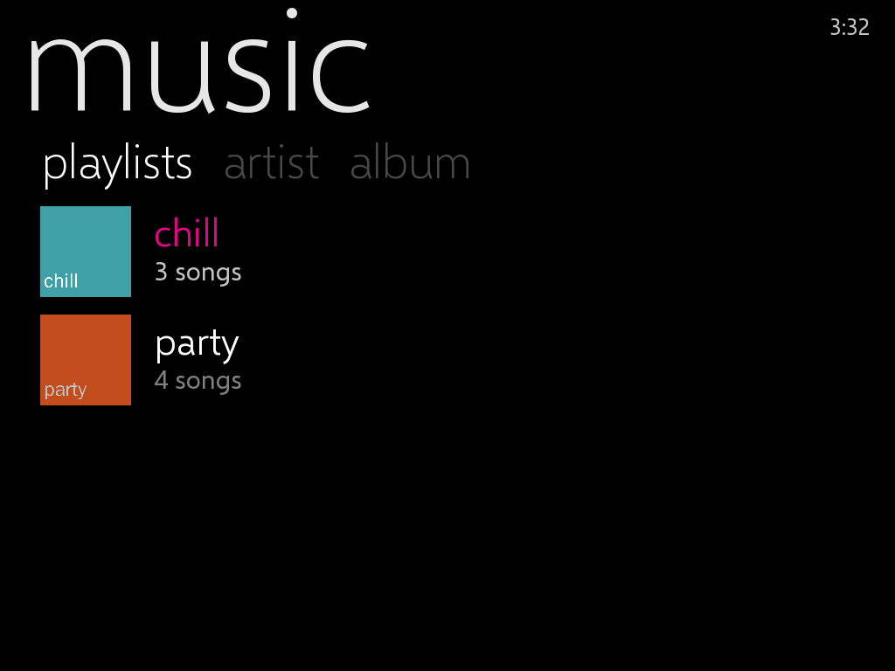

# Game Zune

A **GKD Pixel 2** set up as an offline Game Boy / Game Boy Color / Game Boy Advance
player and music player, with box art, album art, and a **Zune HD interface**.

It is [TortOS](https://github.com/ericreinsmidt/TortOS) (games + music + art, offline)
with a Zune theme added to its launcher.

| Hub | Games | Albums | Mood playlists | Now playing |
|---|---|---|---|---|
|  |  |  |  |  |

*(Screenshots are from the desktop build of the launcher with a demo card. It draws the
same thing the handheld draws, at 1024×768; the Pixel 2 shows it at 640×480.)*

> **Status:** the Zune theme builds for the Pixel 2 and links against the exact
> libraries in the TortOS 1.6.0 image. It has **not been run on a real Pixel 2 yet**.
> Installing it is reversible in one file copy; see [If something goes wrong](#if-something-goes-wrong).

---

## What you get

- **Hub:** big lowercase words (`game boy`, `game boy color`, `game boy advance`, `music`).
  The art for wherever you are in that shelf shows beside them, and "now playing" sits along the bottom.
- **Game lists:** a huge heading that runs off the screen, with **pivots** for the sort order
  (`name · play time · last played · recently added`). Below them is a list of box art and titles.
  The selected title is in Zune magenta.
- **Music:** the same list for albums, with covers and artists. Pivots switch between artist order,
  album order and **playlists**, including mood playlists made from your own library
  (see [Playlists, by mood](#5-playlists-by-mood)).
- **Now playing:** the artist's name drifts enormous across the top, like on the Zune HD.
  Below it are the cover, the track, a magenta progress line and what plays next.
- **Menus** switch to the same typeface, with flat black panels and a magenta accent.
- The font is [Selawik](https://github.com/microsoft/Selawik), Microsoft's open-source
  stand-in for Segoe, the Zune's typeface family.

Everything else is stock TortOS: mGBA for all three Game Boys, the Muse music player,
autosave/resume, favorites, Down To The Wire for files and art over USB.

### Controls on the Zune theme

| Button | Does |
|---|---|
| Up / Down | Move |
| Left / Right | Jump by letter |
| L1 / R1 | Change pivot (sort order) |
| A / B | Open or play / back |
| X / Y | Game details / favorite |
| SELECT | Music (from anywhere) |
| MENU | TortOS menu (UI Theme is in here) |

---

## Setup

### 1. Flash TortOS 1.6.0

1. Download **`TortOS-v1.6.0-pixel2.img.xz`** from the
   [TortOS v1.6.0 release](https://github.com/ericreinsmidt/TortOS/releases/tag/v1.6.0).
2. Write it to a microSD card with [Raspberry Pi Imager](https://www.raspberrypi.com/software/)
   (*Choose OS → Use custom*). This erases the card.
3. Boot the Pixel 2 from it once. The first boot sets up the card. Set the clock in **MENU → Date & Time**.
4. Power off and put the card in your computer. It shows up as **`TORTOS`**.

The Zune build is made for **this exact release**. Its launcher talks to the emulator and
music player beside it, so the versions must match. The install script checks this.

### 2. Install the Zune theme

The ready-built files are in [`dist/TortOS/`](dist/TortOS): the launcher (`tortos.elf`) and its fonts.

**macOS / Linux:**

```sh
scripts/install-to-card.sh /Volumes/TORTOS        # macOS
scripts/install-to-card.sh /media/$USER/TORTOS    # Linux
```

**Windows (or by hand):**

1. On the card, rename `TortOS\tortos.elf` to `tortos.elf.stock`. This is your way back.
2. Copy everything in this repo's `dist\TortOS\` into the card's `TortOS\` folder,
   merging the `fonts` folder.

Eject, put the card in the Pixel 2, power on. A fresh install starts in the Zune theme. If
yours does not, open **MENU → UI Theme → Zune**. *Plain Jane* and *Fancy Pants* are still
there if you want TortOS's own look back.

### 3. Load your games and music

There are two ways onto the card. Use whichever is handier:

- **Card reader:** power the Pixel 2 off, put the microSD in your computer, and copy into
  the `TORTOS` drive. This is the fastest way for a big first load.
- **USB cable, card left in:** on the Pixel 2 open **MENU → Down To The Wire**, then go to
  **http://10.42.0.1** in your computer's browser and enter the PIN shown on the handheld.
  Drag games and music onto the page. This is the easiest way to add a few things later.

The card layout. Only make the folders you use; a system with no games is hidden:

```
TORTOS/
├── Roms/
│   ├── Game Boy/           Tetris (World).gb
│   ├── Game Boy Color/     Pokemon - Crystal Version (USA, Europe).gbc
│   └── Game Boy Advance/   Metroid Fusion (USA).gba
│       └── .media/         Metroid Fusion (USA).png      ← box art (step 4 fills these)
├── Bios/gba_bios.bin                                      ← optional
├── Music/
│   └── Daft Punk/
│       └── Discovery/      01 - One More Time.flac …  cover.jpg
└── Playlists/              chill.m3u8, party.m3u8 …       ← step 5
```

**Games**

- Formats are `.gb`, `.gbc` and `.gba`. Zipped ROMs are fine.
- Keep the **No-Intro names** your files usually come with, e.g. `Metroid Fusion (USA).gba`.
  Box art is matched by file name, and the shelf shows the title without the `(USA)` part.
  The Zune list puts the region underneath instead.
- GBA plays without a BIOS. Add `Bios/gba_bios.bin` only if you want the boot logo.

**Music**

- Formats: MP3, M4A/AAC, FLAC, Ogg, Opus, WAV.
- Muse browses **by folder**, so lay it out as `Music/Artist/Album/NN - Title.ext`.
  If your files are messy, let [MusicBrainz Picard](https://picard.musicbrainz.org/) tag them and lay them out for you, all on your computer:
  1. Drop your music in Picard, click **Cluster**, then **Lookup** (or **Scan**). Check the matches, then **Save**.
  2. Under **Options → File Naming**, turn on **Move files** with the card's `Music` folder as
     the destination, and **Rename files** with this format:
     `$if2(%albumartist%,%artist%)/%album%/$num(%tracknumber%,2) - %title%`
- Songs left loose at the top of `Music/` are gathered into an album called **Singles**.

### 4. Get the box art and album covers

The Pixel 2 has no Wi-Fi, so art comes in through your computer.

**Easiest, both at once:** with the card in the Pixel 2, open **MENU → Down To The Wire**,
go to **http://10.42.0.1** on your computer, and press **Get Box Art and Album Covers**.
Your computer fetches box art from libretro's thumbnail collection and covers from MusicBrainz's
Cover Art Archive, and saves them to the card. Run it again whenever you add things; it only
fetches what is missing.

**For anything it misses:**

| | Where it goes | Tip |
|---|---|---|
| Box art | `Roms/<system>/.media/<ROM name>.png` | The [libretro-thumbnails](https://github.com/libretro-thumbnails) repos (`Nintendo_-_Game_Boy_Advance` → `Named_Boxarts`) have nearly everything. Save it under your ROM's exact file name, ~512 px. Or press **X** on a game on the device to change its cover. |
| Album cover | `cover.jpg` in the album folder, **or** embedded in the files | Picard does this: **Options → Cover Art**, tick *Embed cover images into tags* and *Save cover images as separate files* (`cover`). 500–600 px is plenty. |

Covers embedded in the files are found by themselves. The first time an album shows, Muse pulls
its picture out of the music.

### 5. Playlists, by mood

The music player has a **playlists** pivot. Go to **music**, then use **L1/R1** to move from
**artist** and **album** to **playlists**. It shows every `.m3u` / `.m3u8` file in the card's
`Playlists/` folder, each with its own cover.


**Mood playlists made for you.** [`scripts/moodlists.py`](scripts/moodlists.py) runs on your
computer with the card plugged in. It listens to a minute of every song and measures:

- tempo
- energy
- brightness
- major or minor key
- how danceable it is
- how busy it is

Then it writes seven playlists with Zune-style covers:

**chill · focus · energy · happy · rainy day · late night · party**

```sh
pip install -r scripts/requirements-moods.txt      # librosa, mutagen, pillow (+ ffmpeg for m4a/opus)
python3 scripts/moodlists.py /Volumes/TORTOS       # Windows: python scripts\moodlists.py E:\
```

- **Moods are relative to your library.** "chill" is the calmest part of what *you* own.
- **Tags can steer it.**
  - A song's **MOOD** tag (set it in Mp3tag or Picard: `chill`, `happy`, `sad`, `workout`, `party`…)
    puts it in that playlist whatever it sounds like.
  - The **GENRE** tag nudges the guess (ambient leans chill, house leans party, and so on).
- **Smart DJ mixes:** `--mix "sunday morning=Boards of Canada"` makes a playlist of the songs
  that sound most like an artist, album or song. Repeat `--mix` for as many as you like.
- **Size:** each playlist gets up to `--size 40` songs. A song goes in at most its two best moods,
  so the playlists differ from one another. Each one is ordered by tempo, and the same artist is
  not played twice in a row.
- **Re-running:**
  - The first run takes a while (roughly a second or two per song, using all your cores).
  - What it heard is cached in `Playlists/.moods/`, so a re-run after adding music only listens to the new songs.
  - It only ever replaces playlists it wrote itself.

**Your own playlists** work too. Export an `.m3u` from iTunes/Music, foobar2000, MusicBee or
VLC into `Playlists/`. Muse finds each song on the card by the `Music/…` part of its path, so
`C:\Users\you\Music\Artist\Album\song.mp3` still works. If yours point somewhere else,
`python3 scripts/moodlists.py /Volumes/TORTOS --fix-playlists` repoints them at the card's
copies by file name (the original is kept as `.bak`). Give a playlist a cover by saving a
picture as `Playlists/.media/<playlist name>.jpg`. Otherwise it uses its first song's album art.

---

## If something goes wrong

The launcher is one file on the card, so recovery is easy:

- **Restore stock:** `scripts/install-to-card.sh /path/to/TORTOS --restore`. Or, by hand,
  copy `TortOS/tortos.elf.stock` back over `TortOS/tortos.elf`.
- If the launcher fails to start five times in a row, TortOS powers the device off by
  design. Put the card in your computer and restore as above.
- The log is on the card at `.userdata/pixel2/logs/tortos.log`. It is useful for reporting what happened.

**Updating TortOS:** a newer TortOS image replaces `TortOS/tortos.elf` with its own,
which turns the theme off. To get it back, the patch needs bumping to that release: set the
new version in [`tortos-zune/UPSTREAM`](tortos-zune/UPSTREAM) and rebuild. The patch
touches the launcher only and may apply as is.

---

## Building it yourself

Linux (or WSL). Nothing needs the device:

```sh
# Debian/Ubuntu
sudo apt install git curl xz-utils python3 e2fsprogs make gcc-aarch64-linux-gnu
scripts/build-pixel2.sh      # -> dist/TortOS/
```

The script does four things:

1. Clones TortOS at the pinned release and applies
   the patches in [`tortos-zune/patches/`](tortos-zune/patches).
2. Takes the SDL libraries out of that release's own Pixel 2 image (hash-checked).
3. Cross-compiles the launcher against them.
4. Puts it in `dist/` with the fonts.

To preview on your computer (also regenerates the screenshots above):

```sh
sudo apt install build-essential pkg-config libsdl2-dev libsdl2-image-dev libsdl2-ttf-dev imagemagick ffmpeg xvfb
scripts/preview.sh                      # demo card
CARD=/media/$USER/TORTOS scripts/preview.sh   # your own games and music (read only)
```

### What the patch changes

- `src/zune.c`, `src/zune.h` (new): the drawing. These are the panorama heading, pivots, art lists,
  the hub's word column and quickplay tiles, and Now Playing.
- `src/main.c`:
  - Hooks the theme into the shelves, the Muse album shelf and Now Playing.
  - Makes the list navigation run top to bottom, with L1/R1 as pivots. The sort-step code now lives in
    one shared function, used by both the menu and the pivots.
  - Adds `--theme`, `--sys` and `--sort` to the screenshot harness.
- `src/ui.c`, `src/ui.h`: switching the menu typeface at runtime, and flat panels.
- `src/cards.h`: *Zune* as a third UI Theme, and the default.
- `src/controls.*`: a Controls page for the Zune layout.
- `src/muselib.*` (second patch): playlists. `Playlists/*.m3u` / `.m3u8` are read as albums whose tracks
  live in other albums' folders. Each has its own cover location, and they are shown under a third
  shelf order, *Playlists*. Paths are resolved relative to the playlist, the card, or the `Music/`
  folder in a path from another computer, and never outside the card.

TortOS's own offline checks (`make check`) pass with the patch applied.

---

## Why TortOS (and not plumOS, ROCKNIX, Knulli…)

| | Music library with album art | Box art offline | Games | Zune look possible |
|---|---|---|---|---|
| **TortOS** | Yes (Muse) | Yes, via USB | mGBA | **Yes — this repo** |
| plumOS | No music player found | Scrape on PC | Gambatte, gpSP | Games only (ES theme) |
| ROCKNIX / Knulli | Plays files through mpv / background music only | Scrape on PC | Yes | Games only (ES theme) |

The Pixel 2 has no Wi-Fi or Bluetooth. TortOS is the one that already handles art for that
case, and the one with a real music library, so it is the base.

## Licenses

- This repo: GPL-3.0 ([LICENSE](LICENSE)).
- The patch and `dist/TortOS/tortos.elf` are TortOS modifications. TortOS is MIT,
  © Eric Reinsmidt, and the patch is offered under the same MIT terms so it can go upstream.
- Selawik: SIL Open Font License 1.1, © Microsoft ([fonts/OFL-Selawik.txt](tortos-zune/fonts/OFL-Selawik.txt)).
- "Zune" is a Microsoft trademark. This is an unaffiliated, fan-made look-alike theme.

## Sources

- TortOS: <https://github.com/ericreinsmidt/TortOS>
- plumOS for Pixel 2: <https://github.com/game-de-it/plumOS-pixel2>
- ROCKNIX releases: <https://github.com/ROCKNIX/distribution/releases> · Knulli: <https://github.com/knulli-cfw/knulli-linux/releases>
- Pixel 2 specs: <https://retrocatalog.com/retro-handhelds/gkd-pixel-2>
