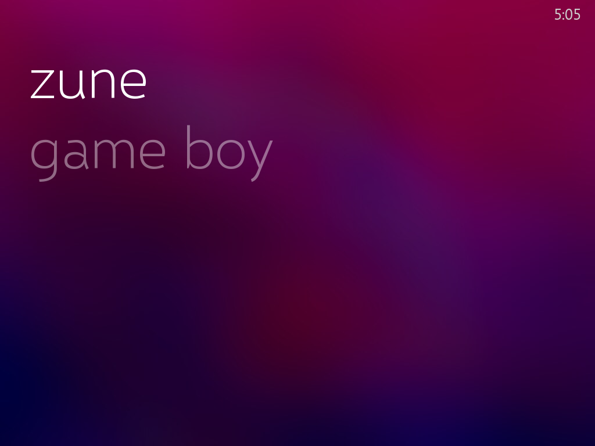
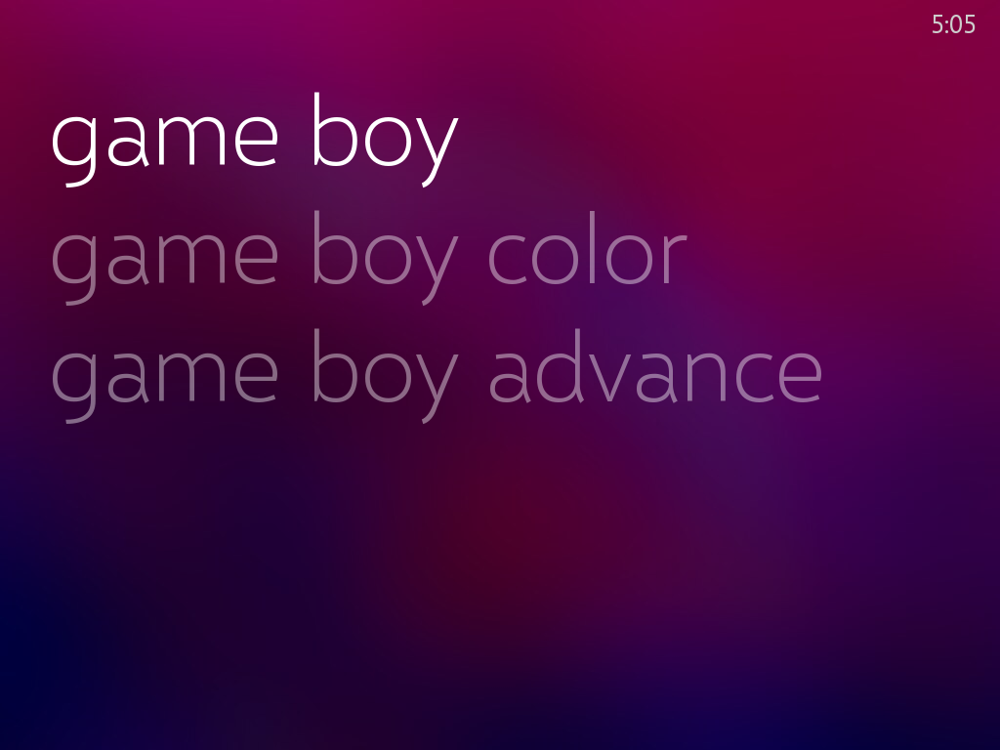
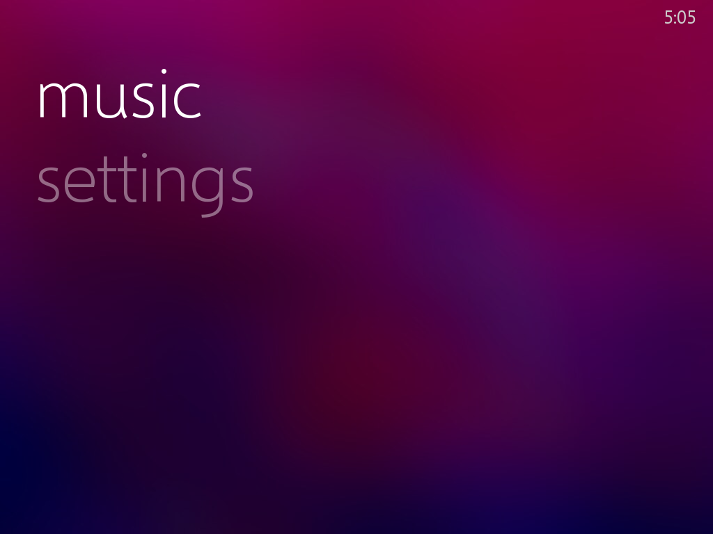
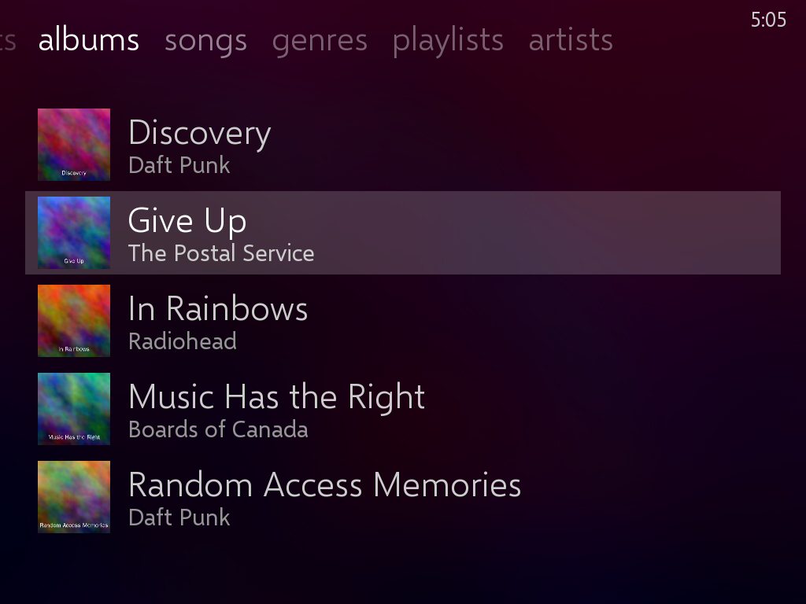
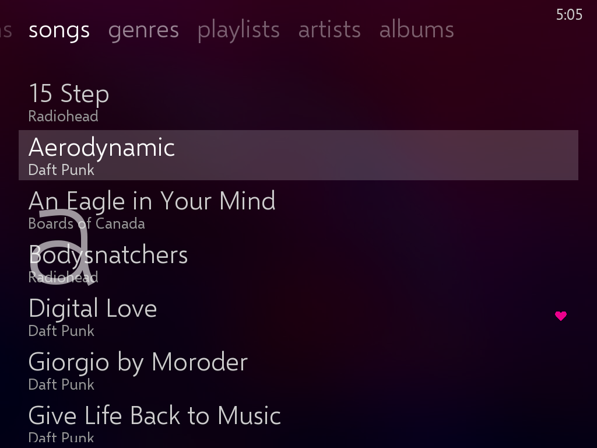
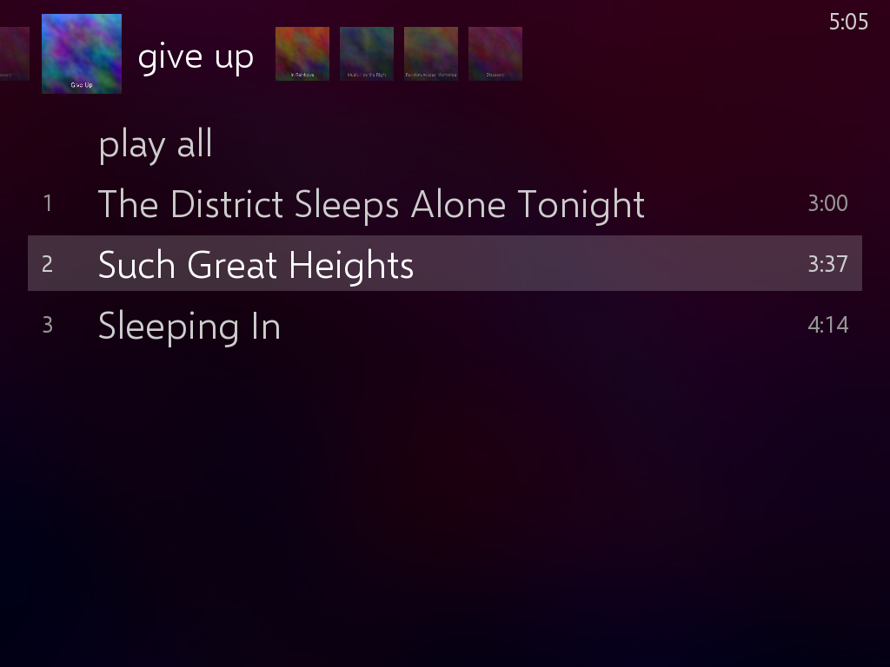
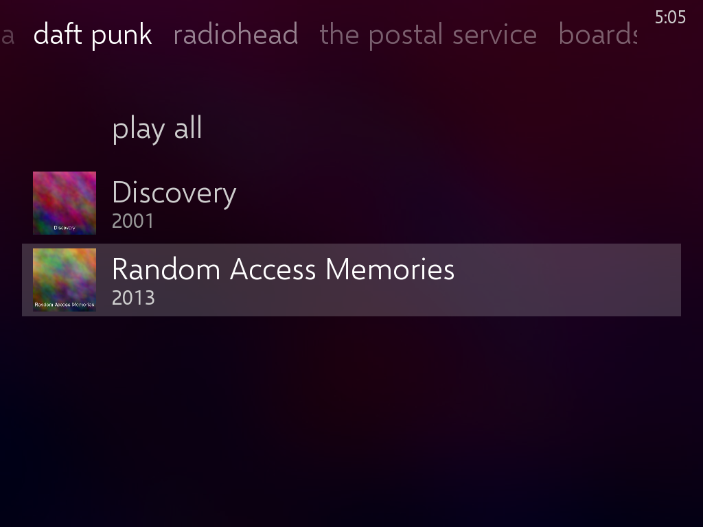
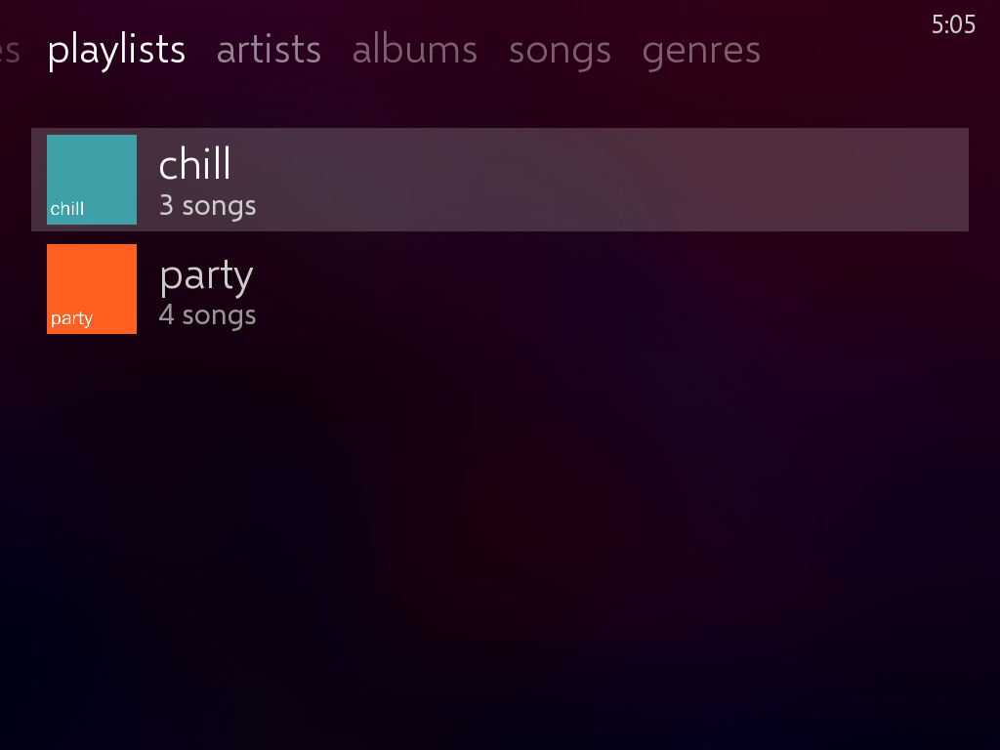
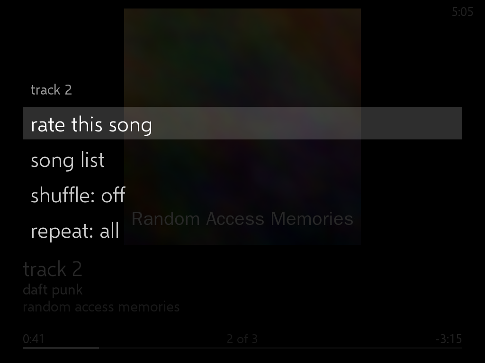
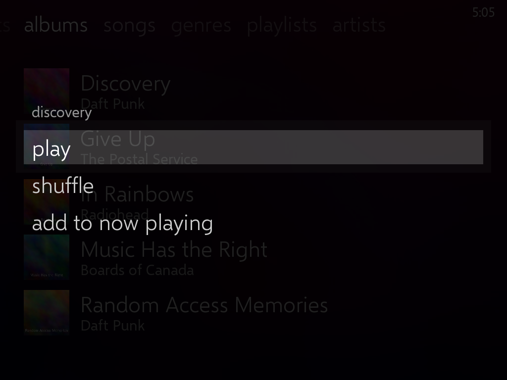

# Game Zune

A **GKD Pixel 2** set up as an offline Game Boy / Game Boy Color / Game Boy Advance
player and music player, with box art, album art, and the interface of the **original Zune**:
the Zune 30, 80 and 120, the ones with buttons and a squircle pad, not the touchscreen Zune HD.

It is [TortOS](https://github.com/ericreinsmidt/TortOS) (games + music + art, offline)
with a Zune theme added to its launcher.

| Top menu | Game Boy | Games | Zune |
|---|---|---|---|
|  |  |  |  |
| **Albums** | **Songs (fast scroll)** | **Album** | **Artist** |
|  |  |  |  |
| **Playlists** | **Now playing** | **Now playing options** | **Options** |
|  |  |  |  |

*(Screenshots are from the desktop build of the launcher with a demo card. It draws the
same thing the handheld draws, at 1024×768; the Pixel 2 shows it at 640×480. The demo
card has no real cover art, so the albums show the Zune's colorful stand-in pattern.)*

> **Status:** the Zune theme builds for the Pixel 2 and links against the exact
> libraries in the TortOS 1.6.0 image. It has **not been run on a real Pixel 2 yet**.
> Installing it is reversible in one file copy; see [If something goes wrong](#if-something-goes-wrong).

---

## What you get

### The top menu: **zune** or **game boy**

Turn it on and there are two words, in the Zune's very large lowercase type over a background
picture: **zune** and **game boy**.

- **zune** is everything music: **music** (and **now playing** while something plays), plus
  **settings**.
- **game boy** is the games: **game boy**, **game boy color** and **game boy advance**.

B always goes back a level, all the way to these two words.

### The original Zune's way of getting around

This follows how the Zune 30/80/120 worked (firmware 2.x/3.x), from the reviews and guides of
the time (see [Sources](#sources)):

- **The twist.** Choose something and its sub-menus run across the top of the screen, the
  current one bright and the rest fading off to the right; the list sits beneath.
  **Left/Right** moves along that row, **Up/Down** through the list. In music the row is
  **artists · albums · songs · playlists · genres** (audiobooks too, if you have any); in games
  it is the three Game Boys, so Left/Right flips between systems.
- **Inside an album, the other albums are the top row**, as tiny covers. Left/Right goes to the
  album next door without going back.
- **"shuffle all"** heads every music list, and **"play all"** heads an artist or an album.
- **Scroll fast** (hold Up/Down) and the letter you've reached shows large on the left, as on
  the Zune. **L1/R1** jump a whole letter.
- **Now Playing** is the album art over about two thirds of the screen, with the song, artist
  and album beneath it, a progress line and "2 of 12". With no cover it shows a colorful
  pattern (one per album, always the same one), the way the first Zune did.
- **The center button on Now Playing** (A, or X) brings up **rate this song**, **song list**
  (what's queued), **shuffle** and **repeat**, like the Zune's.
- **Options anywhere** (X, standing in for holding the center button): **play**, **shuffle**,
  **add to now playing**, and **like / dislike / unrate** on a song.
- **Ratings:** a heart or a broken heart, like the Zune's. Disliked songs are left out of every
  auto playlist.
- **Auto playlists** built from public music databases: chill, workout, dark wave, nostalgia,
  jazzy, party, crowd pleaser, heavy rotation and discover
  (see [Auto playlists](#5-auto-playlists)).
- **Your own background:** put a picture at `TortOS/wallpaper.jpg` (or `.png`) on the card and
  every screen sits on it, darkened so the words read, as the Zune let you pick a background.
  Without one you get the theme's magenta-and-blue blur (`TortOS/zune-wallpaper.jpg`).
- The font is [Selawik](https://github.com/microsoft/Selawik), Microsoft's open-source
  stand-in for Segoe, the Zune's typeface family. Menus use it too.

Everything else is stock TortOS: mGBA for all three Game Boys, the Muse music player,
autosave/resume, favorites, Down To The Wire for files and art over USB.

### Controls on the Zune theme

The Pixel 2's d-pad plays the Zune's squircle pad, **A** its center button, **START** its
play/pause button and **B** its back button.

| Button | Menus | Games | Music lists | Now Playing |
|---|---|---|---|---|
| Up / Down | Move | Move | Move (hold: fast, with the letter) | Volume |
| Left / Right | — | **Twist**: next system | **Twist**: artists, albums… / next album | Skip (hold: scan) |
| L1 / R1 | — | Jump by letter | Jump by letter | Previous / next song |
| A | Open | Play | Open or play | **Options**: rate, song list, shuffle, repeat |
| B | Back | Back | Back | Back |
| X | — | Game details | **Options** | Options |
| Y | — | Favorite | — | — |
| START | — | — | Play / pause | Play / pause |
| SELECT | Music | Music | Close music | Close music |
| MENU | TortOS menu (UI Theme is in here) | TortOS menu | Music menu (rescan, lock…) | Music menu |

---

## Setup

### 1. Flash TortOS 1.6.0

1. Download **`TortOS-v1.6.0-pixel2.img.xz`** from the
   [TortOS v1.6.0 release](https://github.com/ericreinsmidt/TortOS/releases/tag/v1.6.0).
2. Write it to a microSD card with [Raspberry Pi Imager](https://www.raspberrypi.com/software/)
   (*Choose OS → Use custom*). This erases the card.
3. Boot the Pixel 2 from it once. The first boot sets up the card. Set the clock in **MENU → Date & Time**.
4. Power off and put the card in your computer. It shows up as **`TORTOS`**.

The Zune build is made for **this exact release**. Its launcher talks to the emulator and
music player beside it, so the versions must match. The install script checks this.

### 2. Install the Zune theme

The ready-built files are in [`dist/TortOS/`](dist/TortOS): the launcher (`tortos.elf`), its fonts and its background picture (`zune-wallpaper.jpg`).

**macOS / Linux:**

```sh
scripts/install-to-card.sh /Volumes/TORTOS        # macOS
scripts/install-to-card.sh /media/$USER/TORTOS    # Linux
```

**Windows (or by hand):**

1. On the card, rename `TortOS\tortos.elf` to `tortos.elf.stock`. This is your way back.
2. Copy everything in this repo's `dist\TortOS\` into the card's `TortOS\` folder,
   merging the `fonts` folder.

Eject, put the card in the Pixel 2, power on. A fresh install starts in the Zune theme. If
yours does not, open **MENU → UI Theme → Zune**. *Plain Jane* and *Fancy Pants* are still
there if you want TortOS's own look back.

### 3. Load your games and music

There are two ways onto the card. Use whichever is handier:

- **Card reader:** power the Pixel 2 off, put the microSD in your computer, and copy into
  the `TORTOS` drive. This is the fastest way for a big first load.
- **USB cable, card left in:** on the Pixel 2 open **MENU → Down To The Wire**, then go to
  **http://10.42.0.1** in your computer's browser and enter the PIN shown on the handheld.
  Drag games and music onto the page. This is the easiest way to add a few things later.

The card layout. Only make the folders you use; a system with no games is hidden:

```
TORTOS/
├── Roms/
│   ├── Game Boy/           Tetris (World).gb
│   ├── Game Boy Color/     Pokemon - Crystal Version (USA, Europe).gbc
│   └── Game Boy Advance/   Metroid Fusion (USA).gba
│       └── .media/         Metroid Fusion (USA).png      ← box art (step 4 fills these)
├── Bios/gba_bios.bin                                      ← optional
├── Music/
│   └── Daft Punk/
│       └── Discovery/      01 - One More Time.flac …  cover.jpg
└── Playlists/              chill.m3u8, party.m3u8 …       ← step 5
```

**Games**

- Formats are `.gb`, `.gbc` and `.gba`. Zipped ROMs are fine.
- Keep the **No-Intro names** your files usually come with, e.g. `Metroid Fusion (USA).gba`.
  Box art is matched by file name, and the shelf shows the title without the `(USA)` part.
  The Zune list puts the region underneath instead.
- GBA plays without a BIOS. Add `Bios/gba_bios.bin` only if you want the boot logo.

**Music**

- Formats: MP3, M4A/AAC, FLAC, Ogg, Opus, WAV.
- Muse browses **by folder**, so lay it out as `Music/Artist/Album/NN - Title.ext`.
  If your files are messy, let [MusicBrainz Picard](https://picard.musicbrainz.org/) tag them and lay them out for you, all on your computer:
  1. Drop your music in Picard, click **Cluster**, then **Lookup** (or **Scan**). Check the matches, then **Save**.
  2. Under **Options → File Naming**, turn on **Move files** with the card's `Music` folder as
     the destination, and **Rename files** with this format:
     `$if2(%albumartist%,%artist%)/%album%/$num(%tracknumber%,2) - %title%`
- Songs left loose at the top of `Music/` are gathered into an album called **Singles**.

### 4. Get the box art and album covers

The Pixel 2 has no Wi-Fi, so art comes in through your computer.

**Easiest, both at once:** with the card in the Pixel 2, open **MENU → Down To The Wire**,
go to **http://10.42.0.1** on your computer, and press **Get Box Art and Album Covers**.
Your computer fetches box art from libretro's thumbnail collection and covers from MusicBrainz's
Cover Art Archive, and saves them to the card. Run it again whenever you add things; it only
fetches what is missing.

**For anything it misses:**

| | Where it goes | Tip |
|---|---|---|
| Box art | `Roms/<system>/.media/<ROM name>.png` | The [libretro-thumbnails](https://github.com/libretro-thumbnails) repos (`Nintendo_-_Game_Boy_Advance` → `Named_Boxarts`) have nearly everything. Save it under your ROM's exact file name, ~512 px. Or press **X** on a game on the device to change its cover. |
| Album cover | `cover.jpg` in the album folder, **or** embedded in the files | Picard does this: **Options → Cover Art**, tick *Embed cover images into tags* and *Save cover images as separate files* (`cover`). 500–600 px is plenty. |

Covers embedded in the files are found by themselves. The first time an album shows, Muse pulls
its picture out of the music.

### 5. Auto playlists

Under **music → playlists**, next to any playlists of your own, are nine made for you:

| Playlist | What goes in it | Where that comes from |
|---|---|---|
| **chill** | soft, slow songs, but not slow-jam / sensual R&B | genre and mood tags (MusicBrainz, Last.fm); tempo (Deezer); R&B, neo-soul, quiet storm etc. are excluded |
| **workout** | the highest-BPM songs (125+), ordered to build up | tempo from Deezer or the file's tags |
| **dark wave** | darkwave, coldwave, synth-pop, new wave, post-punk: the 80s sound | genres + first-release year (1978–92 favoured) |
| **nostalgia** | songs first released 1998–2010, best known first, no classical / jazz / instrumentals | MusicBrainz first-release year; ListenBrainz popularity |
| **jazzy** | jazz of every kind | genres |
| **party** | europop and eurodance | genres + tempo |
| **crowd pleaser** | songs that reached the **Billboard Hot 100 top 50** | the public Hot 100 archive ([utdata/rwd-billboard-data](https://github.com/utdata/rwd-billboard-data)) |
| **heavy rotation** | your most played | play counts the Pixel 2 now keeps, plus your Last.fm scrobbles if you add them |
| **discover** | what you play least and the world listens to least (changes daily) | your play counts + ListenBrainz/Deezer popularity |

They are made on your computer by [`scripts/zunesync.py`](scripts/zunesync.py), with the card plugged in:

```sh
pip install -r scripts/requirements.txt              # mutagen, pillow
python3 scripts/zunesync.py /Volumes/TORTOS          # Windows: python scripts\zunesync.py E:\
```

What it does:

1. Reads each song's tags: artist, title, year, genre, any BPM or MOOD tag, and the MusicBrainz
   IDs if Picard tagged it.
2. Looks each song up in free public databases:
   - **[MusicBrainz](https://musicbrainz.org)**: first-release year, genres and tags.
   - **[ListenBrainz](https://listenbrainz.org)**: how many people listen to it.
   - **[Deezer](https://developers.deezer.com)**: tempo (BPM), popularity, release date.
   - **Billboard Hot 100 history**: chart peaks.
   - **[Last.fm](https://www.last.fm/api)**, optional: the best "vibe" tags. Get a free key at
     <https://www.last.fm/api/account/create> and add
     `--lastfm-key YOURKEY --lastfm-user YOURNAME` (the user part also counts your scrobbles in
     heavy rotation).
3. Reads what the **Pixel 2 recorded**: every song you listened to for 30 seconds or half its
   length is logged to `Music/.zune/plays.log`, and your hearts to `ratings.tsv`.
4. Writes the nine playlists with Zune-style covers. It also writes `Music/.zune/library.tsv`,
   which gives the Pixel 2 real song titles, genres (the **genres** twist), years, lengths and
   tags.

Things to know:

- **The first run is slow, on purpose.** MusicBrainz asks for one request a second, so expect
  about one to two seconds per song. Everything is cached in `Music/.zune/lookup.json`, so later
  runs only look up new songs.
- **Listening is only a fallback.** If no database or tag knows a song's tempo and `librosa` is
  installed, it analyses a minute of the song for BPM. That is the only listening it does.
- **Tags help.** A song tagged with a **MOOD** (`chill`, `workout`, `party`, `jazz`) in Mp3tag or
  Picard goes into that playlist whatever the databases say. Picard tagging also gives exact
  MusicBrainz matches.
- **Re-run it** after adding music or listening for a while, so heavy rotation and discover
  catch up. `--offline` rebuilds from the cache alone, and `--only "chill,party"` makes just those.
- It only replaces playlists it wrote. A song you **disliked** on the Pixel 2 is in none of them.

**Your own playlists** work too. Export an `.m3u` from iTunes/Music, foobar2000, MusicBee or
VLC into `Playlists/`. Muse finds each song on the card by the `Music/…` part of its path, so
`C:\Users\you\Music\Artist\Album\song.mp3` still works. If yours point somewhere else,
`python3 scripts/zunesync.py /Volumes/TORTOS --fix-playlists` repoints them at the card's
copies by file name (the original is kept as `.bak`). Give a playlist a cover by saving a
picture as `Playlists/.media/<playlist name>.jpg`. Otherwise it uses its first song's album art.

---

## If something goes wrong

The launcher is one file on the card, so recovery is easy:

- **Restore stock:** `scripts/install-to-card.sh /path/to/TORTOS --restore`. Or, by hand,
  copy `TortOS/tortos.elf.stock` back over `TortOS/tortos.elf`.
- If the launcher fails to start five times in a row, TortOS powers the device off by
  design. Put the card in your computer and restore as above.
- The log is on the card at `.userdata/pixel2/logs/tortos.log`. It is useful for reporting what happened.

**Updating TortOS:** a newer TortOS image replaces `TortOS/tortos.elf` with its own,
which turns the theme off. To get it back, the patch needs bumping to that release: set the
new version in [`tortos-zune/UPSTREAM`](tortos-zune/UPSTREAM) and rebuild. The patch
touches the launcher only and may apply as is.

---

## Building it yourself

Linux (or WSL). Nothing needs the device:

```sh
# Debian/Ubuntu
sudo apt install git curl xz-utils python3 e2fsprogs make gcc-aarch64-linux-gnu
scripts/build-pixel2.sh      # -> dist/TortOS/
```

The script does four things:

1. Clones TortOS at the pinned release and applies
   the patches in [`tortos-zune/patches/`](tortos-zune/patches).
2. Takes the SDL libraries out of that release's own Pixel 2 image (hash-checked).
3. Cross-compiles the launcher against them.
4. Puts it in `dist/` with the fonts.

To preview on your computer (also regenerates the screenshots above):

```sh
sudo apt install build-essential pkg-config libsdl2-dev libsdl2-image-dev libsdl2-ttf-dev imagemagick ffmpeg xvfb
scripts/preview.sh                      # demo card
CARD=/media/$USER/TORTOS scripts/preview.sh   # your own games and music (read only)
```

### What the patch changes

- `src/zune.c`, `src/zune.h` (new): the drawing - the main menu's words over the background
  picture, the twist row (words or tiny covers), lists with "shuffle all" / "play all", the
  fast-scroll letter, the options menu, hearts, the no-art pattern and Now Playing.
- `src/main.c`:
  - Hooks the theme into the shelves, the Muse album shelf and Now Playing.
  - The top menu (**zune** / **game boy**), the game boy menu, and the games list as a twist
    across the three systems.
  - Now Playing's Zune keys: A/X for its options, START play/pause, the pad to skip/scan and for
    volume.
  - Adds `--theme`, `--sys`, `--sort`, `--zmusic` and `--zlevel` to the screenshot harness.
- `src/ui.c`, `src/ui.h`: switching the menu typeface at runtime, and flat panels.
- `src/cards.h`: *Zune* as a third UI Theme, and the default.
- `src/controls.*`: a Controls page for the Zune layout.
- `src/muselib.*` (second patch): playlists. `Playlists/*.m3u` / `.m3u8` are read as albums whose tracks
  live in other albums' folders. Each has its own cover location, and they are shown under a third
  shelf order, *Playlists*. Paths are resolved relative to the playlist, the card, or the `Music/`
  folder in a path from another computer, and never outside the card.
- Third patch, the music collection's data:
  - `src/zune_music.h` (new, included into `main.c`): reads `library.tsv`, `plays.log` and
    `ratings.tsv`, and (since the fourth patch) is the twist browser and the zune menu.
  - `src/musec.*`, `src/musequeue.*`: counting a listen (30 s or half the song, seeking excluded),
    adding to the queue without interrupting it, and jumping within it.
  - `src/device/brick.c`: the rest of the pad on the desktop build's keyboard, for driving it in tests.
- Fourth patch: the original Zune's look in place of the third patch's Zune HD-style screens, and
  the top menu.

TortOS's own offline checks (`make check`) pass with the patches applied.
`python3 -m unittest discover -s scripts/tests` tests the playlist rules against a fake web and
the Billboard data (set `BILLBOARD_CSV` to a downloaded `hot-100-current.csv` to use the real archive).

---

## Why TortOS (and not plumOS, ROCKNIX, Knulli…)

| | Music library with album art | Box art offline | Games | Zune look possible |
|---|---|---|---|---|
| **TortOS** | Yes (Muse) | Yes, via USB | mGBA | **Yes — this repo** |
| plumOS | No music player found | Scrape on PC | Gambatte, gpSP | Games only (ES theme) |
| ROCKNIX / Knulli | Plays files through mpv / background music only | Scrape on PC | Yes | Games only (ES theme) |

The Pixel 2 has no Wi-Fi or Bluetooth. TortOS is the one that already handles art for that
case, and the one with a real music library, so it is the base.

## Licenses

- This repo: GPL-3.0 ([LICENSE](LICENSE)).
- The patch and `dist/TortOS/tortos.elf` are TortOS modifications. TortOS is MIT,
  © Eric Reinsmidt, and the patch is offered under the same MIT terms so it can go upstream.
- Selawik: SIL Open Font License 1.1, © Microsoft ([fonts/OFL-Selawik.txt](tortos-zune/fonts/OFL-Selawik.txt)).
- "Zune" is a Microsoft trademark. This is an unaffiliated, fan-made look-alike theme.

## Sources

- TortOS: <https://github.com/ericreinsmidt/TortOS>
- plumOS for Pixel 2: <https://github.com/game-de-it/plumOS-pixel2>
- ROCKNIX releases: <https://github.com/ROCKNIX/distribution/releases> · Knulli: <https://github.com/knulli-cfw/knulli-linux/releases>
- Pixel 2 specs: <https://retrocatalog.com/retro-handhelds/gkd-pixel-2>

How the original Zune looked and worked:

- Wikipedia: [Zune 30](https://en.wikipedia.org/wiki/Zune_30),
  [Zune 80, 120](https://en.wikipedia.org/wiki/Zune_80,_120),
  [Zune 4, 8, 16](https://en.wikipedia.org/wiki/Zune_4,_8,_16),
  [Zune software version history](https://en.wikipedia.org/wiki/Zune_software_version_history)
- Gizmodo, [Complete guide to Zune 2's software and firmware](https://gizmodo.com/complete-guide-to-zune-2s-software-and-firmware-321605)
  and [Zune 3.0 software review](https://gizmodo.com/microsoft-zune-3-0-software-review-5051440)
- Engadget, [New Zune review, part 2](https://www.engadget.com/2007-11-18-new-zune-review-part-2-upgrade-hardware-software-and-social.html)
- Laptop Mag, [Zune 80GB review](https://www.laptopmag.com/reviews/mp3/microsoft-zune-80gb-and-zune-marketplace-software-v-2-1)
- The Gadgeteer, [Zune 8GB review](https://the-gadgeteer.com/2008/03/21/zune_8gb/)
- Futurelooks, [Zune 80GB review](https://www.futurelooks.com/microsoft-zune-80gb-digital-media-player-review/3/)
- istartedsomething, [Zune v2 software: now playing](https://istartedsomething.com/20071113/zune-v2-software-now-playing/)
- ITPro Today, [Zune 2 review, part 1: software](https://itprotoday.com/it-infrastructure/zune-2-review-part-1-software)
